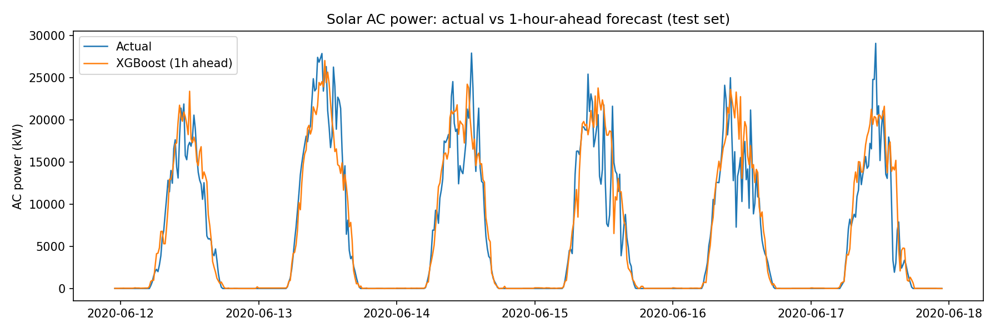
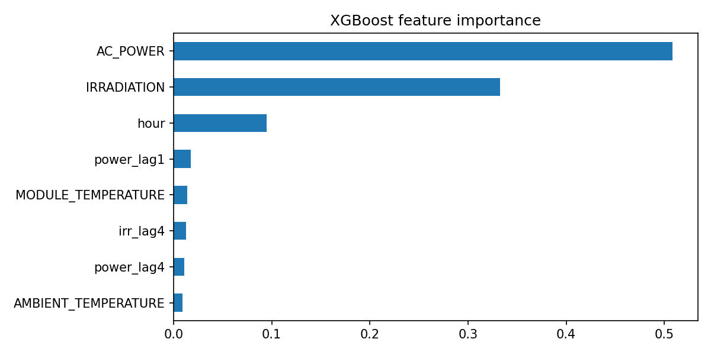

# Solar Power Forecasting: 1-Hour Ahead with XGBoost

Short-term forecasting of a solar plant's AC power using recent power readings and weather sensor data. Accurate short-term solar forecasts support grid balancing, storage planning and flexibility in power systems with a high share of renewables.

## Results

Evaluated on a held-out **6-day test set** (time-based split, no shuffling):

| Model | MAE (kW) | RMSE (kW) |
|---|---|---|
| Baseline: persistence | 2362.2 | 3915.1 |
| Baseline: same time yesterday | 1837.4 | 3595.0 |
| **XGBoost** | **1389.2** | **2660.2** |

XGBoost reduced RMSE by **32.1%** vs the persistence baseline and by **26.0%** vs the same-time-yesterday baseline.

The forecast follows the daily solar cycle closely but lags behind abrupt changes (likely passing clouds), since the model only sees current and past readings.

## Approach

1. Parse and merge inverter-level generation data (summed per timestamp) with weather sensor data.
2. Fill short gaps (up to 1 hour) by interpolation.
3. Build time-of-day, lag and weather features.
4. Split by time: the last 6 days are the test set.
5. Compare XGBoost against two simple baselines using MAE and RMSE.

## Data

[Solar Power Generation Data](https://www.kaggle.com/datasets/anikannal/solar-power-generation-data) (Kaggle): two solar plants in India, 34 days, 15-minute resolution. This project uses **Plant 1**. The data is not included in this repository; download it from Kaggle.

## Run it

Kaggle notebook: [Solar Power Forecasting: 1-Hour Ahead with XGBoost](https://www.kaggle.com/code/emanhishamismail/solar-power-forecasting-1-hour-ahead-with-xgboost)

Or run locally after downloading the dataset and changing the data path in the loading cell. Requirements: `pandas`, `numpy`, `matplotlib`, `scikit-learn`, `xgboost`.

## Limitations and next steps

- Only 34 days of data, so results are indicative, not a general benchmark.
- One plant and one season.
- Next: test generalisation on Plant 2, compare an LSTM, try other horizons, and use a numerical weather forecast as an input.

## Author

Eman Hisham Ismail | [LinkedIn](https://linkedin.com/in/eman-hisham-607411283) | [Kaggle](https://kaggle.com/emanhishamismail)
